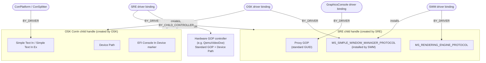
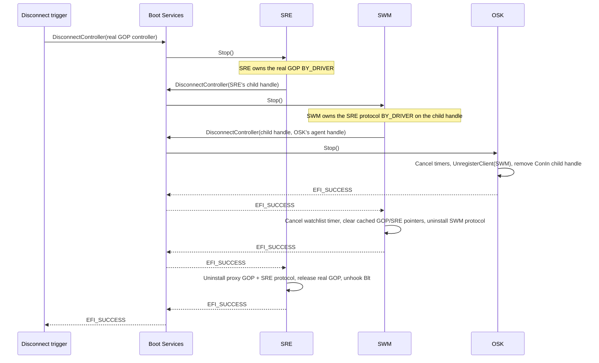

# MsGraphicsPkg Teardown and Reconnect Refactor UEFI Driver Model Design

## Table of Contents

- [Scope](#scope)
- [Background](#background)
  - [Brief Overview of the UEFI Driver Model](#brief-overview-of-the-uefi-driver-model)
  - [Brief Overview of the Graphics and Input Stack](#brief-overview-of-the-graphics-and-input-stack)
- [What Led to a Driver Model Refactor: A Page Fault During Graphics Teardown](#what-led-to-a-driver-model-refactor-a-page-fault-during-graphics-teardown)
  - [Symptom](#symptom)
  - [Cause](#cause)
- [Fix: Refactor to Use the Driver Model](#fix-refactor-to-use-the-driver-model)
  - [Simple Rendering Engine (SRE): Graphics Controller and Its Child Handle](#simple-rendering-engine-sre-graphics-controller-and-its-child-handle)
  - [Simple Window Manager (SWM): Dual-Purpose Binding](#simple-window-manager-swm-dual-purpose-binding)
  - [On-Screen Keyboard (OSK): A Managed Console Input Device](#on-screen-keyboard-osk-a-managed-console-input-device)
  - [Simple Window Manager Dialogs Library (SwmDialogsLib)](#simple-window-manager-dialogs-library-swmdialogslib)
  - [Overall Handle Topology](#overall-handle-topology)
- [Teardown](#teardown)
- [Reconnecting and Restarting: One-Time vs. Per-Binding State](#reconnecting-and-restarting-one-time-vs-per-binding-state)
- [Some Remaining Gaps](#some-remaining-gaps)
- [Further Reading](#further-reading)

## Scope

The UEFI Driver Model is used in MsGraphicsPkg to manage the lifecycle of graphics and input drivers, ensuring proper
attachment, detachment, and reconnection of these components.

This applies to three MsGraphicsPkg drivers in particular: the Simple Rendering Engine (SRE), the Simple Window Manager
(SWM), and the On-Screen Keyboard (OSK). A long-standing issue in MsGraphics to date has been a page fault during
disconnect and reconnect. It is expected the refactor to address that is the first of what will be several refactors
to address remaining gaps as noted in the [Some Remaining Gaps](#some-remaining-gaps) section.

In this document, the relevant Driver Binding relationships will be examined to explain why their
current relationships are structured the way they are, what problem that design solves, and how these drivers are
connected, disconnected, and reconnected.

This document intentionally does not cover rendering internals (fonts, bitmaps, the Simple UI Toolkit details), HII and
theme details, etc. beyond what is needed to explain the driver model details. For a package-level overview, see the
[MsGraphicsPkg ReadMe](../ReadMe.rst).

Also, there was a balance to strike between not completely rewriting the MsGraphicsPkg drivers to address all known
problems versus scoping a refactor to address the most pressing issue, which in this case is the teardown and
reconnection process.

If future refactors are done to address remaining gaps, it is suggested that those be documented in a similar document
to this one, but leave this document as a reference for the refactor that addresses the teardown and reconnection
process.

## Background

### Brief Overview of the UEFI Driver Model

The UEFI Driver Model (described in the UEFI Specification) is how DXE drivers attach to and detach from devices
("controllers," represented by handles) without hardcoding load order or device knowledge into each other. A
driver that wants to manage a controller installs an `EFI_DRIVER_BINDING_PROTOCOL` with three callbacks:

- `Supported()`: a quick check of whether this driver can manage the candidate controller.
- `Start()`: takes ownership of the controller's resources and publishes whatever new protocol interfaces this
  driver produces.
- `Stop()`: relinquishes ownership and undoes everything `Start()` did.

Two details are especially important for the remainder of this document:

- **`OpenProtocol()` attributes record relationships.** When a driver calls `OpenProtocol()`
  with `EFI_OPEN_PROTOCOL_BY_DRIVER`, the core remembers that this driver is managing that protocol instance on
  that controller. If the interface later needs to go away, `DisconnectController()` on the controller calls
  `Stop()` on every driver that holds a `BY_DRIVER` open, deterministically. Looking a protocol up with
  `LocateProtocol()` or `HandleProtocol()` does not create such a record. Nothing will invoke the caller back when
  that protocol is removed.
- **`EFI_OPEN_PROTOCOL_BY_CHILD_CONTROLLER` records parent and child handles.** A driver that creates a new handle
  out of an existing one (the way a bus driver enumerates a child device) records that relationship the same way,
  so disconnecting the parent also disconnects the child.

A single driver can hold both kinds of relationship at once. As the next section shows, SRE is a `BY_DRIVER`
consumer of the hardware GOP and, in the same `Start()` call, the creator of a new child handle of its own.

### Brief Overview of the Graphics and Input Stack

| Component                                       | Role                                                                                                                                                                                             |
| ----------------------------------------------- | ------------------------------------------------------------------------------------------------------------------------------------------------------------------------------------------------ |
| Hardware GOP driver (for example, QemuVideoDxe) | Produces the real `EFI_GRAPHICS_OUTPUT_PROTOCOL` for the physical or virtual display.                                                                                                            |
| SRE (Simple Rendering Engine)                   | Takes ownership of the hardware GOP and republishes a "proxy GOP" plus a private surface-compositing protocol, so several "windows" can share one framebuffer.                                   |
| SWM (Simple Window Manager)                     | Aggregates pointer input (mouse, touch) from multiple sources into one stream, and uses SRE to give each registered client ("window") its own drawing surface.                                   |
| OSK (On-Screen Keyboard)                        | A touch-friendly virtual keyboard. It is itself an SWM client, and it also publishes standard console input protocols so any firmware code reading keystrokes sees it like an ordinary keyboard. |
| GraphicsConsole                                 | Draws the UEFI text console on top of a GOP (here, SRE's proxy GOP).                                                                                                                             |
| ConPlatform / ConSplitter                       | Standard EDK II console policy and aggregation drivers that assemble the system console from whatever console-capable devices are connected.                                                     |

SRE, SWM, and OSK are drivers in MsGraphicsPkg. GraphicsConsole, ConPlatform, and
ConSplitter are standard `MdeModulePkg` console drivers, included here only because they share the same handle
chain described below.

## What Led to a Driver Model Refactor: A Page Fault During Graphics Teardown

### Symptom

Prior to a refactor to have the MsGraphicsPkg drivers more fullyparticipate in the UEFI Driver Model, they located most
protocol dependencies without tracking them through the UEFI Driver Model and caching pointers in to global
variables. Driver binding relationships were established only for for a small subset of devices, namely pointer-input
controllers. While this could generally result in functional behavior, it became problematic when graphics
could be disconnected and reconnected at runtime.

For example, a page fault could occur when graphics was disconnected and later reconnected while the system was running,
such as when running the UEFI Shell commands `disconnect` followed by `connect`, or `reconnect -r`, which disconnects
every handle in the system and then reconnects console-related device paths. Shortly after `OnScreenKeyboardDxe`
reported stopping, the firmware crashed inside `SimpleWindowManagerDxe`, at the line that reads the current
screen resolution from a cached GOP pointer:

```c
ScreenMaxX = mGop->Mode->Info->HorizontalResolution;
```

That line runs inside `CheckWatchListCallback()`, a periodic timer callback that polls pointer-input providers on
a short interval. The crash meant the timer was still running, and `mGop` (or its `Mode` field) no longer pointed
at anything valid, after graphics had already been disconnected.

### Cause

Before the refactor, `SimpleWindowManagerDxe`'s `EFI_DRIVER_BINDING_PROTOCOL` only managed pointer-input
controllers (mice, touch panels). Graphics was handled differently: SWM located the GOP and SRE
protocols with `LocateProtocol()` calls (or a registration-notify callback that did the same lookup), cached
the resulting pointers in module-level globals (`mGop`, `mRenderingEngine`), and did not establish a formal driver
model relationship with them.

That is the type of problem a `BY_DRIVER` relationship exists to solve. Nothing could call SWM
back when graphics went away. Its watchlist timer, initialized once at startup and left running for the lifetime of the
driver, kept reading `mGop` on every notification tick regardless of what had happened to the graphics stack under
it.

Meanwhile, SRE did act as a `BY_DRIVER` consumer of the hardware GOP, so disconnecting the graphics
controller called SRE's `Stop()`. Stopping released SRE's internal context, which SWM's cached `mGop`
pointer pointed directly into:

```c
ZeroMem (&mSRE, sizeof (mSRE));
...
mParentGop      = NULL;
mParentHandle   = NULL;
mSREGopHandle   = NULL;
```

`mSRE.Gop` (the "proxy GOP" structure SWM had cached a pointer to) is managed inside that context, so this `ZeroMem()`
turned `mGop->Mode` into `NULL` without ever freeing or moving the underlying memory. The next scheduled tick of
SWM's still-running timer dereferenced that `NULL` `Mode` pointer, producing the page fault. `OnScreenKeyboardDxe`
had the same exposure (it also cached a raw GOP pointer and an SWM-protocol pointer it never opened `BY_DRIVER`),
which is why its restart behavior needed its own matching set of fixes alongside SWM's.

## Fix: Refactor to Use the Driver Model

The change made was to give SWM,
and then OSK, a tracked relationship with the graphics layer, so each one is told to stop, and actually
cancels its own timers and clears its own cached pointers, before the interfaces it depends on are removed.

### Simple Rendering Engine (SRE): Graphics Controller and Its Child Handle

SRE's functional role did not change in the refactor, it is still the foundation everything else attaches to.
The following is a summary of SRE's Driver Binding:

- `Supported()` tests whether the candidate controller has a usable `EFI_GRAPHICS_OUTPUT_PROTOCOL` which is not already
  wrapped by SRE, with mode data and a `Blt` function present.
- `Start()` opens that GOP `BY_DRIVER | EXCLUSIVE`, taking ownership of the parent (real) GOP handle. It then
  creates a new child handle (`mSREGopHandle`) carrying a "proxy GOP" (the standard `gEfiGraphicsOutputProtocolGuid`,
  with its own mode data copied from the parent so it stays valid even if the parent's mode structure changes
  shape) and the private `MS_RENDERING_ENGINE_PROTOCOL`. It registers that child with
  `OpenProtocol(parent, GOP, BY_CHILD_CONTROLLER, ChildHandle=mSREGopHandle)`, hooks the parent's `Blt` function
  last (once everything it depends on is ready), and calls `ConnectController()` on the new child so downstream
  consumers can attach.
- `Stop()` explicitly calls `DisconnectController(mSREGopHandle, NULL, NULL)` before uninstalling the child's
  protocols. That call is what forces every driver attached to the child handle to stop first, instead of
  leaving the order up to whatever else happens to be tearing down the system at the same time.

SRE also has some resilience against a producer that does not follow the driver model. `IsParentGopValid()` re-checks,
before every use of the cached parent GOP, that the controller handle still has the expected interface pointer.
This is a safety net for a producer that uninstalls its GOP without calling `DisconnectController()`.

One historical detail worth knowing: SRE and the hardware GOP driver used to exclusively coordinate through a private
"override" protocol GUID (`PcdMsGopOverrideProtocolGuid`), with a separate `GopOverrideDxe` helper driver that
renamed an already-installed standard GOP to that GUID after the fact. That existed because SRE's
`Supported()`/`Start()` used to look for the override GUID specifically. SRE now opens the standard
`gEfiGraphicsOutputProtocolGuid` directly, so a hardware GOP driver that publishes the standard protocol does not need a
helper. The override GUID and `GopOverrideDxe` remain available for producers that still want to publish
privately, for example to keep a GOP out of general discovery until a platform is ready to hand it to SRE.

### Simple Window Manager (SWM): Dual-Purpose Binding

SWM's Driver Binding now manages two different kinds of controllers, branching internally on what the candidate
controller carries:

- **Pointer providers** (the original role). `Supported()`/`Start()` claim a physical `EFI_ABSOLUTE_POINTER_PROTOCOL`
  `BY_DRIVER | EXCLUSIVE` and add it to SWM's polling watchlist. This part is unchanged.
- **The graphics controller** (new). `Supported()` checks for `gMsSREProtocolGuid`. `Start()` opens it `BY_DRIVER`
  on SRE's child handle, reads the GOP from that same handle, and installs
  `gMsSWMProtocolGuid` on that same handle rather than on SWM's own image handle. That means the SWM protocol's
  lifetime is now tied to a specific, disconnectable controller.

The following are key mechanisms used to support teardown and reinitialization:

- **`DisconnectSwmServiceAgents()`.** Before SWM's `Stop()` does anything else, it walks every agent that opened
  `gMsSWMProtocolGuid` `BY_DRIVER` on the controller (in practice, OSK) and calls `DisconnectController()` on each
  one. This forces those dependents to stop before SWM uninstalls the protocol they were relying on, rather than
  depending on the core happening to visit them in a safe order.
- **One-time versus per-binding state.** Fonts, HII string packages, the base pointer-aggregation client, and the
  Simple UI Toolkit only need to be set up once per image (`mSwmOneTimeInitDone`). Screen dimensions, the
  watchlist timer, and the `gMsSWMProtocolGuid` installation are rebuilt every time graphics (re)connects.
  Separating these means SWM can be stopped and started repeatedly without leaking resources or re-registering
  state that is still valid.

When SWM's graphics `Stop()` runs, it cancels the watchlist timer, hides the mouse pointer, and clears `mGop` and
`mRenderingEngine` back to `NULL`, before returning control to what disconnected it. A small
loop also closes any leftover client paint events it finds still registered, as a safety net for a display client
that (unlike OSK) does not yet fully participate in the driver model (see
[Some Remaining Gaps](#some-remaining-gaps)).

### On-Screen Keyboard (OSK): A Managed Console Input Device

After the recent refactor, OSK's Driver Binding now depends on SWM similar to how SWM depends on SRE:

- `Supported()` checks for `gMsSWMProtocolGuid` on the candidate controller, which is SRE's child handle, since
  that is where SWM now installs it.
- `Start()` opens that protocol `BY_DRIVER`, reads the GOP from the same handle, and creates its own new child
  handle carrying a Device Path, Simple Text In, Simple Text In Ex, and the EFI Console In Device marker protocol
  that tells ConPlatform/ConSplitter this is a console input device. It registers that child with
  `OpenProtocol(Controller, SWM, BY_CHILD_CONTROLLER, ChildHandle=OskConInHandle)`, and registers itself as an
  SWM client to get pointer input and a paint event.
- `Stop()` tears down in the matching order. It dismisses any on-screen presentation, cancels its own timers,
  unregisters its SWM client, uninstalls the ConIn child handle's protocols, and only then closes its `BY_DRIVER`
  open on the SWM protocol.

Creating a dedicated child handle, rather than installing Simple Text In/Ex directly on SWM's controller handle,
matters for two notable reasons. It lets OSK add and remove its own interfaces without disturbing anything else
published on that handle, and it gives OSK's console device its own position in the device path, extending the
controller's device path the same way SRE's child extends the hardware GOP's.

With this in place, every bind cycle is symmetric, with `Start()` registering a client and creating a child handle,
and `Stop()` unregistering that client and destroying that child handle. OSK's one-time state, the
`MS_ONSCREEN_KEYBOARD_PROTOCOL` used to configure presentation (position, size, visibility) and the two
`WaitForKey`/`WaitForKeyEx` events ConSplitter latches onto, is created once at the driver's entry point and
persists across any number of bind and stop cycles. That lets a platform configure OSK before any display exists, and
lets OSK restart cleanly without those handles going stale.

### Simple Window Manager Dialogs Library (SwmDialogsLib)

`SwmDialogsLib` is a library linked into arbitrary applications and drivers, so it has no Driver Binding and no
controller to manage. Only one agent can hold `BY_DRIVER` on a protocol instance, and OSK already holds it on the
SWM protocol, so the library cannot use the same mechanism. Prior to the refactor, it located the SWM and GOP protocols once
and kept the pointers, which can go stale after graphics is disconnected and reconnected.

It now re-resolves both protocols at the start of every public prompt, re-runs `InitializeUIToolKit()` so the
toolkit's cached pointers are refreshed, and returns `EFI_ABORTED` if graphics is not currently available.

`SwmDialogsReady()` applies the same availability check. This bounds staleness to a single dialog call without too
much overhead, and leaves the Simple UI Toolkit unchanged. It does not guard against a dialog that is already on screen
when graphics is disconnected, but that scenarios is considered acceptable for the intended use cases.

### Overall Handle Topology

There is a chain of controller handles, each managed by its own set of drivers and exposing its own protocols.



Every solid arrow in this diagram is a relationship that is tracked and can be acted on.

## Teardown

Disconnecting the hardware GOP controller triggers a deterministic, synchronous chain:



The goal of the refactor to address teardown is to make this process reliable.

- **Teardown is driven by explicit code.** SRE's `Stop()`
  calls `DisconnectController()` on its child handle. SWM's `Stop()` calls `DisconnectController()`
  targeting OSK. Each call is synchronous, by the time it returns, what is downstream has finished
  stopping. This allows disconnect to work regardless of which handle is disconnected first. If SRE's child handle is
  directly disconnected, SWM and OSK still stop in
  the same order and SRE's `Stop()` that executes later simply finds nothing left to disconnect.
- **Each layer cancels its timers and clears its cached pointers before returning.** SWM cancels the
  watchlist timer (that used to crash), and sets `mGop` back to `NULL`, before its `Stop()` call returns to SRE.
  SRE's `ZeroMem()` of its own context, which used to race with SWM's timer, now only happens after SWM (and
  transitively OSK) have already stopped reading it.

GraphicsConsole's teardown is independent of this chain, it holds its own `BY_DRIVER` open on the "proxy GOP" and
is stopped the same way, but it does not read graphics state from a background timer, so its relative ordering
was not a factor in past teardown issues.

## Reconnecting and Restarting: One-Time vs. Per-Binding State

| Component | Set up once per image                                                                                                            | Rebuilt on every graphics bind                                                              |
| --------- | -------------------------------------------------------------------------------------------------------------------------------- | ------------------------------------------------------------------------------------------- |
| SWM       | Fonts and HII packages, the base pointer-aggregation client, Simple UI Toolkit initialization (guarded by `mSwmOneTimeInitDone`) | Screen dimensions, the watchlist timer, the `gMsSWMProtocolGuid` installation itself        |
| OSK       | `MS_ONSCREEN_KEYBOARD_PROTOCOL` and its persisted presentation settings, the `WaitForKey`/`WaitForKeyEx` events                  | The SWM client registration, the ConIn child handle, the key-repeat and display-mode timers |
| SRE       | Not applicable. SRE only supports one graphics controller at a time                                                              | The "proxy GOP", the SRE protocol, the child handle, the surface-sampling timer             |

This separation is why reconnecting graphics, or recovering after a controller disappears and later comes back
(handled by `ConnectGraphicsController()` and `ConnectSwmController()`, only requires rebuilding the per-binding column.

## Some Remaining Gaps

The refactor work done at this time primarily addressed the issue of tearing down and restarting the graphics
related gaps remain, called out below, they were intentionally left for future work.

- The Simple UI Toolkit (`InitializeUIToolKit`) still caches the GOP and SWM pointers found with
  `LocateProtocol()`. `SwmDialogsLib` refreshes them at the start of each prompt (see
  [Simple Window Manager (SWM): Dual-Purpose Binding](#simple-window-manager-swm-dual-purpose-binding)), but a dialog already on
  screen when graphics is disconnected is not protected, and other toolkit users such as DisplayEngineDxe
  initialize it from their own entry points without refreshing.
- SWM still supports only a single graphics controller at a time (`mGraphicsController`), and its graphics discovery
  (`ConnectGraphicsController()`) still scans for `gMsSREProtocolGuid` handles and calls `ConnectController()`
  directly, rather than relying on platform connection policy with `Supported()` evaluated first. OSK's
  `ConnectSwmController()` works the same way.
- A future display client that registers with SWM (`SWMRegisterClient()`) but does not participate in the
  driver model the way OSK now does would fall back to SWM's backup cleanup loop in `Stop()`. That loop closes
  the client's paint event and surface, but leaves the client's registration in the list. It does not provide the
  clean, symmetric register and unregister cycle OSK gets through its own Driver Binding.

## Further Reading

- [UEFI Specification, chapter 11, "UEFI Driver Model"](https://uefi.org/specs/UEFI/2.11/11_Protocols_UEFI_Driver_Model.html)
- [UEFI Specification, section 7.3, "Protocol Handler Services"](https://uefi.org/specs/UEFI/2.11/07_Services_Boot_Services.html)
  (`OpenProtocol`/`DisconnectController` semantics)
- [RenderingEngine.c](../RenderingEngineDxe/RenderingEngine.c)
- [WindowManager.c](../SimpleWindowManagerDxe/WindowManager.c) and
  [SimpleWindowManagerProtocol.c](../SimpleWindowManagerDxe/SimpleWindowManagerProtocol.c)
- [OnScreenKeyboardDriver.c](../OnScreenKeyboardDxe/OnScreenKeyboardDriver.c)
- [GopOverrideDxe.c](../GopOverrideDxe/GopOverrideDxe.c)
